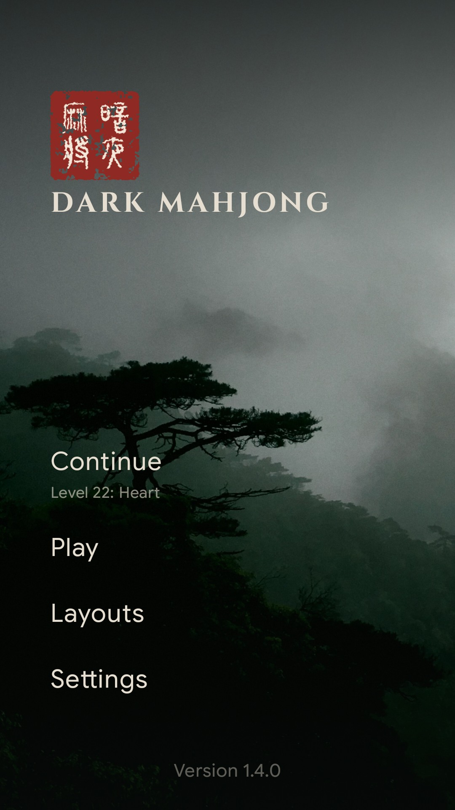
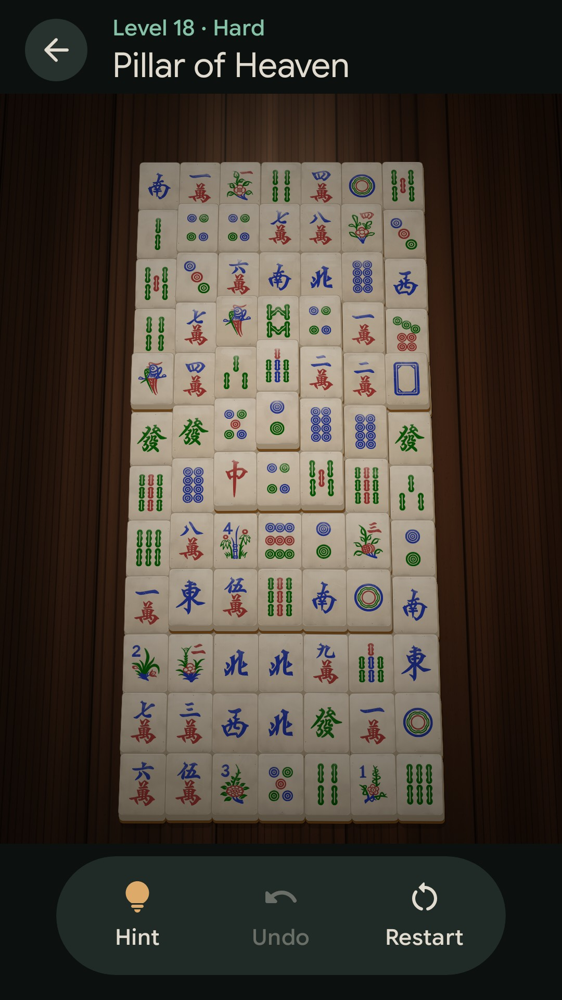
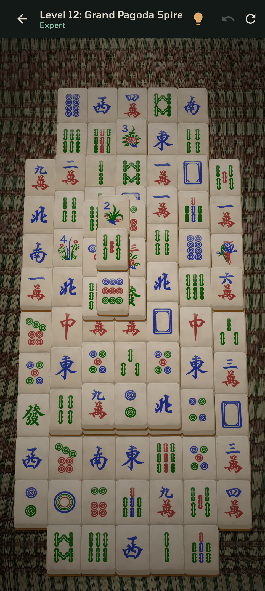
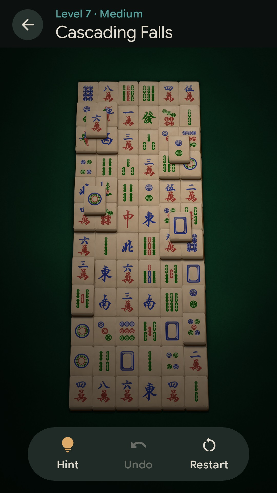
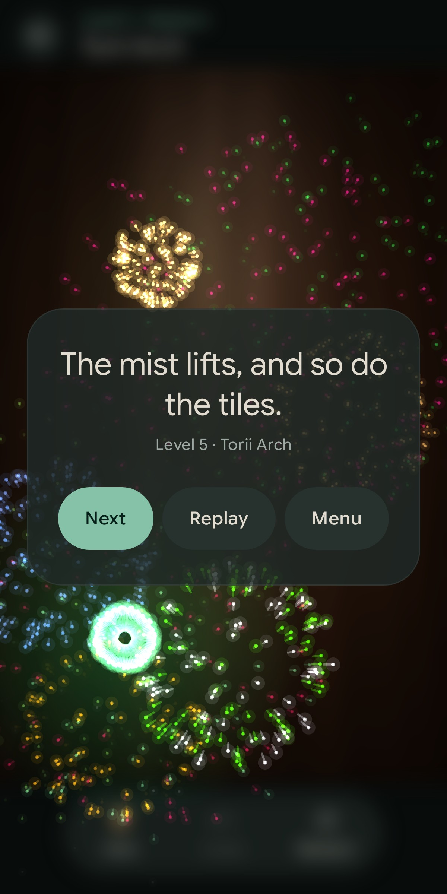
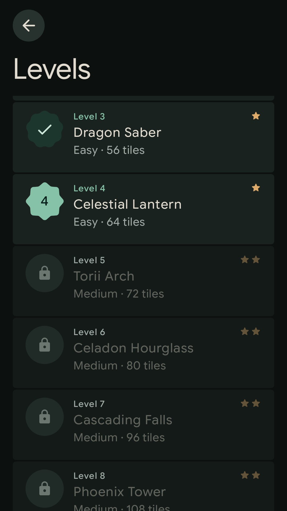

# Dark Mahjong

[](LICENSE)
[](https://developer.android.com)

A calm, moody mahjong solitaire for Android, played by lamplight. Glossy, well-worn tiles on a softly lit table in a dark room; misty mountains on the title screen; no timers, scores or interruptions.

Dark Mahjong is a fork of **[Mahjong Solitaire by PcmciaKai](https://github.com/PcmciaKai/mahjong_solitaire)**, whose solid, guaranteed-solvable game engine it builds on. The fork changes the look and the feel. The rules are the same: match free pairs until the table is clear.

<p align="center">
  
  
  
</p>
<p align="center">
  
  
  
</p>

## What's different from the original

### A darker ambience
- **One lamp over the table.** The table is lit by a single warm lamp and the room falls away into darkness. Tiles and tabletop share the same light, brightest in the middle and dim at the edges, but never too dark to read a tile.
- **A misty title screen.** A real photograph of Sanqing Mountain in cloud, darkened, with subtle film grain (an AGSL shader). Above it sits a name seal, **暗夜麻將** ("dark-night mahjong"), in genuine seal script.
- **Dark everywhere else too.** One quiet colour palette, minimalist menus, no light theme.
- **Android 17's look.** Material 3 Expressive throughout the menus and controls, set in Google Sans Flex: collapsing large titles, segmented settings lists, shape-morphing buttons, a floating game toolbar, blur behind dialogs, and the predictive back gesture. The launcher icon is the name seal.

### A different look
- **Seen at an angle.** The table is viewed slightly away from overhead, in true perspective: far rows recede and each tile's front edge shows, without ever hiding a tile's face.
- **Glossy, well-used tiles.** A thick clear glaze reflects the lamp in streaks, broken up by tiny ripples in the glaze. Every tile is a little different: hairline scratches, grime in patches, the odd ding, ivory from crisp to yellowed, sitting a fraction off-square. The artwork is engraved into the face.
- **Three tabletops,** all rendered live in perspective: **Walnut** (lacquered boards), **Green Mat** (felt) and **Thai Straw** (a well-used woven sedge mat).
- **Portrait-first,** because most layouts are taller than they are wide.
- **54 layouts:** the original's 25, plus 29 boards from [Mah](https://github.com/ffalt/mah) (animals, plants, symbols, shapes and buildings), chosen to suit a phone held upright. Pinch to zoom in on any of them. Levels and the Layouts list both run from easy to hard.

### More relaxed play
- **No timer, no scores, no statistics, no best times.** Progress is simply how far you've come.
- **Unlimited** hints, undo and reshuffles, and every board is guaranteed solvable (from the original engine).
- **A gentle reward.** Clearing a board brings a fireworks show seen from above, in widely varied colours, and a warm message drawn from a large pool that doesn't repeat until you've seen them all.
- **Quiet touches.** Soft clicks and light haptics, and everything respects the sound, vibration and animation settings.
- **No ads, no tracking, no network access.**

### Coming next
Next up is a first release on Google Play. After that: a 300-level journey with gradual difficulty, a daily puzzle, quick games by difficulty, and high-contrast tile sets. See [docs/DESIGN.md](docs/DESIGN.md).

## Requirements

- Android 13 (API 33) or newer: the lighting, tabletops and effects are GPU shaders (AGSL).

## Building

Gradle with the included wrapper; JDK 17 or newer.

```sh
# Debug build
./gradlew assembleDebug

# Release build (minified, unsigned)
./gradlew assembleRelease

# Unit tests, plus screenshots of every main screen rendered on the JVM
# (shaders included) into app/build/screenshots
./gradlew testDebugUnitTest
```

`tools/deploy-to-phone.sh [--no-launch] [adb-serial]` builds a small minified APK, signs it with the local debug key and installs it over adb.

## AI disclosure

The original project's code was largely written with AI tools (see the [upstream README](https://github.com/PcmciaKai/mahjong_solitaire)). Dark Mahjong's changes were made by Gareth working with Claude, Anthropic's AI. In keeping with the original's spirit, this project is and remains open source.

## Licences and credits

- **Code:** [GNU GPL v3](LICENSE), with the original's [App Store Exception](NOTICE.md#app-store-exception-additional-permission-under-gplv3-section-7). Original code © 2026 PcmciaKai.
- **Tile artwork:** [samoheen/mahjong-tiles](https://github.com/samoheen/mahjong-tiles), CC0.
- **Layouts:** 29 boards from [Mah](https://github.com/ffalt/mah) by ffalt, MIT licence.
- **Title photograph:** *Sanqing Mountain is surrounded by clouds and mists* by Huangdan2060, [CC0](https://commons.wikimedia.org/wiki/File:Sanqing_Mountain_is_surrounded_by_clouds_and_mists1.jpg), Wikimedia Commons (cropped and graded).
- **Thai straw mat:** drawn procedurally, modelled on *Cambodian mat motifs* by Willuconquer ([CC BY-SA 4.0](https://commons.wikimedia.org/wiki/File:Cambodian_mat_motifs.jpg), Wikimedia Commons). No image is included.
- **Name seal:** 全字庫說文解字 seal-script font, CNS11643, Ministry of Digital Affairs, Taiwan ([cns11643.gov.tw](https://www.cns11643.gov.tw)), Open Government Data License 1.0 (subset to four characters).
- **Fonts:** [Cinzel](https://fonts.google.com/specimen/Cinzel) by Natanael Gama and [Google Sans Flex](https://fonts.google.com/specimen/Google+Sans+Flex) by the Google Sans Flex Project Authors, both SIL OFL 1.1.
- **Background music:** from the original project, AI-generated with Suno and dedicated to the public domain (CC0).
- **Sound effects:** tile taps from [Kenney](https://kenney.nl/assets/impact-sounds) (CC0); the match sound was made for Dark Mahjong (CC0); the win melody is a dizi phrase by [CarlosCarty](https://freesound.org/people/CarlosCarty/sounds/339357/) (CC0); the fireplace is a recording by [Christopher C. Courter](https://freesound.org/people/courter/sounds/447818/) (CC0).

Full details are in [NOTICE.md](NOTICE.md).
